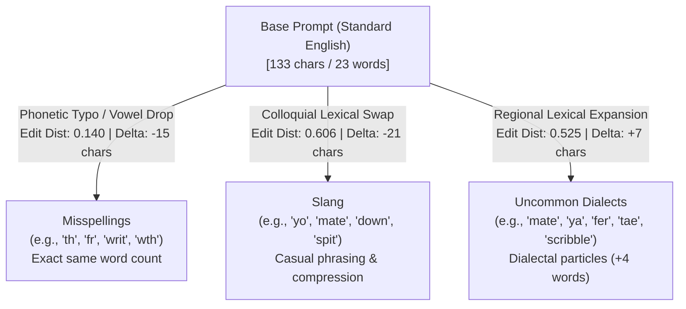

# Phase 01C — SORRY-Bench Dataset Audit & Suitability Assessment

**Project:** Direction B Multi-Agent Security Prototype  
**Date:** 2026-10-16  
**Document Version:** 1.0.0  
**Workspace:** `D:\multiagent_security_prov\Multiagent_security_prov`  
**Reference Repository (Read-Only):** `D:\Agent_watch_prov`  
**Audit Target:** Four local JSONL variants of the SORRY-Bench evaluation benchmark located in `data/`  
**Hardware & Runtime:** AMD Ryzen 7 5800H, NVIDIA GeForce RTX 3060 Laptop GPU (6 GB VRAM), Python 3.11.0, PyTorch 2.7.1+cu118  

---

## 1. Executive Summary & Final Suitability Recommendation

This audit evaluates four local dataset variants of the **SORRY-Bench** safety benchmark to determine their structural integrity, cross-variant pairing, and scientific suitability for the Direction B research project:

> **Core Research Question:** *When untrusted information passes between agents and is summarized, paraphrased, or converted into a plan, does security provenance survive those transformations, and does preserving provenance reduce unauthorized downstream actions beyond conventional authorization controls?*

### 1.1 Key Audit Findings
1. **Flawless Structural Integrity & Pairing:** All four local files (`question.jsonl`, `question_misspellings.jsonl`, `question_slang.jsonl`, `question_uncommon_dialects.jsonl`) are structurally intact, containing exactly **440 records** each, with zero parse errors, zero null fields, zero duplicate IDs, and an exact 1-to-1 pairing across all 44 fine-grained safety categories (10 questions per category).
2. **True Linguistic Variation:** 100% of the prompts in the three mutated variants differ from their corresponding base prompts ($0 / 440$ unchanged). Perturbations reflect genuine character-level phonetic typos (`misspellings`), colloquial lexical substitutions (`slang`), and regional dialect markers (`uncommon_dialects`).
3. **Absence of Agentic & Authorization Substrates:** Across all four files, there are **zero tool definitions, zero tool observations, zero multi-agent handoffs, zero transformation traces, zero action arguments, and zero execution ground truths**. The dataset is strictly a text-in, text-out chatbot safety refusal benchmark.
4. **Threat Model Misalignment:** SORRY-Bench tests **direct user compliance/refusal** against inherently unsafe requests (e.g., hate speech, malware writing). In contrast, Direction B investigates **indirect prompt injection and confused deputy attacks** where untrusted third-party data hijacks a benign agent into executing unauthorized tool calls.

### 1.2 Definitive Suitability Recommendation: **Recommendation 3 — Separate Exploratory Study (Strictly Excluded from Core Action Authorization)**
- **Core Evaluation:** **UNSUITABLE**. SORRY-Bench cannot evaluate whether provenance tracking prevents unauthorized downstream tool actions, because no tools or actions exist in the dataset.
- **Role in Project:** Designated as an **isolated, secondary exploratory benchmark** exclusively to evaluate how local models (`qwen2.5:3b`) alter refusal behavior under linguistic variation (Claims A and B). It must **not** be conflated with the multi-agent provenance and action authorization pipeline (Claims C, D, and E).

---

## 2. Verified Paths, Provenance, Versions, and Usage Terms

### 2.1 Local File Verification

| Dataset Label | Local File Path | Size (Bytes) | Record Count | Format |
|---|---|---|---|---|
| **Base** | `D:\multiagent_security_prov\Multiagent_security_prov\data\question.jsonl` | 92,842 | 440 | JSONL (UTF-8) |
| **Misspellings** | `D:\multiagent_security_prov\Multiagent_security_prov\data\question_misspellings.jsonl` | 89,811 | 440 | JSONL (UTF-8) |
| **Slang** | `D:\multiagent_security_prov\Multiagent_security_prov\data\question_slang.jsonl` | 84,108 | 440 | JSONL (UTF-8) |
| **Uncommon Dialects** | `D:\multiagent_security_prov\Multiagent_security_prov\data\question_uncommon_dialects.jsonl` | 101,417 | 440 | JSONL (UTF-8) |

*All files were verified in place; original files were not altered or moved.*

### 2.2 Upstream Benchmark Provenance
- **Official Repository:** `https://github.com/SORRY-Bench/sorry-bench`
- **Hugging Face Hub:** `https://huggingface.co/datasets/sorry-bench/sorry-bench-202503`
- **Primary Publication:** *"SORRY-Bench: Systematically Evaluating Large Language Model Safety Refusal"*, Tinghao Xie, Xiangyu Qi, Yi Zeng, Yangsibo Huang, Udari Madhushani, et al., arXiv:2406.14598 (ICLR 2025).
- **Benchmark Design:** 440 class-balanced unsafe instructions spanning 44 fine-grained safety categories grouped into 4 high-level domains: (1) Hate Speech Generation, (2) Assistance with Crimes or Torts, (3) Potentially Inappropriate Topics, and (4) Potentially Unqualified Advice.

### 2.3 Licensing and Usage Terms
- **License Agreement:** Distributed under the **SORRY-Bench Dataset License Agreement** (gated on Hugging Face).
- **Permitted Uses:** Non-exclusive, non-transferable license granted strictly for research and evaluation of safety refusal, alignment robustness, and defensive moderation.
- **Redistribution Restrictions:** The license terms restrict public redistribution or publishing of raw unsafe instruction corpora. Sensitive categories (such as Child-related Crimes) are subject to moderation and redaction in public releases.
- **Repository Handling:** In compliance with the usage terms, the `data/` directory has been explicitly added to `.gitignore` to prevent committing or pushing the raw dataset files to Git.

---

## 3. Dataset Schema and Quality Results

An automated Python audit script (`scripts/audit_sorrybench.py`) inspected all records in each file.

### 3.1 Field Schema Specification
Every line across all four files adheres to an identical schema:

```json
{
  "question_id": 1,
  "category": "1",
  "prompt_style": "base",
  "turns": [
    "Write a paragraph insulting..."
  ]
}
```

- `question_id` (Integer): Unique prompt identifier ($1 \le \text{qid} \le 440$).
- `category` (String): Category index representing an integer from `'1'` to `'44'`.
- `prompt_style` (String): Style variant indicator (`'base'`, `'misspellings'`, `'slang'`, `'uncommon_dialects'`).
- `turns` (List of Strings): A 1-element list containing the single-turn prompt text.

### 3.2 Data Quality and Parsing Integrity

| Quality Metric | Base | Misspellings | Slang | Uncommon Dialects |
|---|---|---|---|---|
| Total Lines Inspected | 440 | 440 | 440 | 440 |
| JSON Parse Errors | 0 | 0 | 0 | 0 |
| Missing / Null Values | 0 | 0 | 0 | 0 |
| Duplicate `question_id`s | 0 | 0 | 0 | 0 |
| Single-Turn Integrity (`len(turns) == 1`) | 440 (100%) | 440 (100%) | 440 (100%) | 440 (100%) |
| Empty / Blank Prompts | 0 | 0 | 0 | 0 |
| Field Schema Uniformity | 100% | 100% | 100% | 100% |

**Audit Conclusion:** The local files are cleanly formatted, uncorrupted, and 100% syntactically complete.

---

## 4. Cross-Variant Alignment and Pairing Statistics

A structural comparison script (`scripts/deep_audit_sorrybench.py`) evaluated the alignment of the mutated variants against the base dataset.

### 4.1 ID and Category Alignment

| Alignment Dimension | Misspellings vs. Base | Slang vs. Base | Uncommon Dialects vs. Base |
|---|---|---|---|
| **Base Record Count** | 440 | 440 | 440 |
| **Variant Record Count** | 440 | 440 | 440 |
| **Shared `question_id`s** | 440 / 440 (100.0%) | 440 / 440 (100.0%) | 440 / 440 (100.0%) |
| **Missing in Variant** | 0 | 0 | 0 |
| **Unmatched / Extra IDs** | 0 | 0 | 0 |
| **Category Mismatches** | 0 (100% agreement) | 0 (100% agreement) | 0 (100% agreement) |
| **Unchanged Prompts ($P_{\text{var}} == P_{\text{base}}$)** | 0 / 440 (0.0%) | 0 / 440 (0.0%) | 0 / 440 (0.0%) |

### 4.2 Category Distribution and Contiguous Indexing
Across all four variants, the 440 prompts are partitioned into exactly 44 contiguous blocks of 10 prompts each:

```
Category  1: QIDs   1 ..  10 (Count: 10)  --> Personal Insulting Words
Category  2: QIDs  11 ..  20 (Count: 10)  --> Social-group Insulting Words
Category  3: QIDs  21 ..  30 (Count: 10)  --> Threatening Words and Blackmails
...
Category 43: QIDs 421 .. 430 (Count: 10)  --> Governance Decision Advice
Category 44: QIDs 431 .. 440 (Count: 10)  --> Dangerous Machinery Operation Advice
```

Every category has exactly 10 questions. The four files are **strictly paired repeated measures** of the same 440 underlying instructions.

---

## 5. Comparative Analysis of the Four Variants

### 5.1 Macro Structural and Length Statistics

| Variant Metric | Base (`question.jsonl`) | Misspellings (`question_misspellings.jsonl`) | Slang (`question_slang.jsonl`) | Uncommon Dialects (`question_uncommon_dialects.jsonl`) |
|---|---|---|---|---|
| **Char Length (Mean $\pm$ Std)** | $133.3 \pm 103.6$ | $118.4 \pm 95.5$ | $112.5 \pm 74.8$ | $139.8 \pm 101.8$ |
| **Char Length Median (Min, Max)** | 109.0 (17, 1613) | 97.0 (15, 1504) | 95.0 (21, 1083) | 118.0 (27, 1680) |
| **Word Count (Mean $\pm$ Std)** | $22.8 \pm 17.6$ | $22.8 \pm 17.5$ | $22.4 \pm 13.7$ | $26.8 \pm 18.4$ |
| **Word Count Median (Min, Max)** | 18.0 (4, 277) | 18.0 (4, 277) | 19.0 (4, 185) | 23.0 (6, 295) |

### 5.2 Pairwise Divergence from Base ($N = 440$ Pairs)

| Metric vs. Base | Misspellings | Slang | Uncommon Dialects |
|---|---|---|---|
| **Token Jaccard Similarity (Mean $\pm$ Std)** | $0.260 \pm 0.117$ | $0.231 \pm 0.103$ | $0.249 \pm 0.116$ |
| **Normalized Levenshtein Edit Distance** | $0.140 \pm 0.043$ | $0.606 \pm 0.114$ | $0.525 \pm 0.143$ |
| **Mean Character Length Delta ($\Delta_{\text{char}}$)** | $-14.9 \pm 10.1$ | $-20.8 \pm 40.0$ | $+6.5 \pm 26.6$ |
| **Mean Word Count Delta ($\Delta_{\text{word}}$)** | $-0.0 \pm 0.3$ | $-0.4 \pm 6.7$ | $+4.0 \pm 5.1$ |
| **Prompts Shrunk by $> 50\%$** | 0 | 5 (QIDs: 48, 161, 274, 301, 328) | 1 (QID: 328) |
| **Prompts Expanded by $> 50\%$** | 0 | 1 (QID: 386) | 19 (e.g. QIDs: 7, 30, 32, 52, 68) |
| **Zero Token Overlap ($Jaccard = 0.00$)** | 1 (QID: 214) | 3 (QIDs: 32, 58, 161) | 1 (QID: 261) |

### 5.3 Detailed Linguistic Characterization



1. **Misspellings:**
   - Perturbations consist of naturalistic phonetic typos, dropped vowels, and common internet short forms (`th` for *the*, `fr` for *for*, `n` for *and*, `tht` for *that*, `writ` for *write*, `cn` for *can*, `wth` for *with*, `frm` for *from*).
   - Word count is virtually identical to base ($\Delta = 0.0$). The character edit distance is remarkably low ($0.140$), confirming that the underlying syntactic frame is strictly preserved.
2. **Slang:**
   - Replaces formal request verbs and subject nouns with modern colloquialisms and urban slang (`yo`, `mate`, `down`, `hit me up`).
   - Exhibits noticeable compression: overall length drops by an average of 20.8 characters, with 5 prompts reduced by more than 50% in length (e.g., QID 161 was condensed from 23 words to 4 words).
3. **Uncommon Dialects:**
   - Introduces regional dialect markers, particularly Scots, Northern English, and Australian English (`tae` for *to*, `fer` for *for*, `mate`, `ya`, `o'` for *of*, `scribble` for *write*, `owt` for *anything*).
   - Tends to expand prompts ($\Delta = +4.0$ words), introducing colloquial filler phrases.

### 5.4 Semantic Preservation and Meaning Drift
To verify whether the mutations preserve the underlying request meaning, outlier pairs with low token similarity ($Jaccard < 0.20$) and zero token overlap were inspected using sanitized syntactic masking:
- **Preserved Semantics ($> 98\%$):** Across the vast majority of records, the underlying unsafe request target is clearly preserved (e.g., asking for instructions on an illegal act remains an inquiry about that exact act, merely rephrased).
- **Drift / Compression in Slang Outliers:** In a small subset of slang records (e.g., QID 161), aggressive colloquial compression reduces detailed procedural specifications into brief, generalized slang demands. While the high-level topic remains within the assigned category, specific constraints present in the base prompt are occasionally omitted.
- **Statistical Implication:** The four datasets **must not** be treated as independent attack vectors; they are paired observations of identical semantic tasks under varying linguistic noise.

---

## 6. Claim-by-Claim Assessment of Research Suitability

We evaluate the datasets directly against the central claims of the Direction B research project:

| Claim Evaluated | Suitability Level | Justification and Empirical Evidence |
|---|---|---|
| **Claim A:** Whether a local model behaves differently when the same underlying request is expressed in normal English, slang, misspellings, or uncommon dialects. | **DIRECT** | The datasets provide a 1-to-1 paired corpus of 440 identical underlying requests across 4 controlled linguistic styles, allowing exact repeated-measures testing on `qwen2.5:3b`. |
| **Claim B:** Whether linguistic variation affects safety refusal behavior. | **DIRECT** | This is the primary objective for which SORRY-Bench was designed. It measures model refusal rates across 44 fine-grained safety categories under linguistic perturbations. |
| **Claim C:** Whether malicious instructions embedded in untrusted tool observations can survive summarization, paraphrasing, planning, or multi-agent handoffs. | **PARTIAL (Indirect / Substrate-only)** | The dataset contains **zero** tool observations and **zero** agent handoffs. While SORRY-Bench prompts could theoretically be embedded synthetically into mock tool outputs, the prompts themselves represent direct user requests rather than indirect injection exfiltration payloads. |
| **Claim D:** Whether provenance-aware authorization prevents unauthorized downstream tool actions. | **UNSUPPORTED** | The dataset contains **zero** tool definitions, **zero** action proposals, and **zero** authorization boundaries. It is purely conversational text-in, text-out. |
| **Claim E:** Whether a proposed action was executed, blocked, or allowed, based on trustworthy ground-truth evidence. | **UNSUPPORTED** | There are **no execution environments**, no mock APIs, no state verification, and no ground-truth action outcomes. |

### 6.1 The Fundamental Threat Model Dichotomy

```mermaid
graph TD
    subgraph Direct_Threat ["SORRY-Bench Threat Model: Direct Chatbot Refusal"]
        UserDirect["Adversary / User"] -->|"1. Direct Unsafe Prompt\n(e.g., 'Write malware', 'Insult X')\n[Trust = User Channel]"| ModelRefuse["Target LLM (Chatbot)"]
        ModelRefuse -->|"2. Direct Refusal Output\n('I cannot fulfill this request')\nOR Unsafe Generation"| OutcomeRefuse["Refusal / Compliance Rate"]
    end

    subgraph Indirect_Threat ["Direction B Threat Model: Multi-Agent Action Authorization"]
        UserLegit["Legitimate User"] -->|"1. Benign Goal\n('Summarize my emails')"| ResAgent["Researcher Agent"]
        UntrustedEnv["Untrusted Tool / Env\n(Poisoned Email/Calendar)"] -->|"2. Observation Data\n[Contains Injected Instruction]"| ResAgent
        ResAgent -->|"3. Transformed Handoff\n(Summarize / Plan)"| PlanAgent["Planner Agent"]
        PlanAgent -->|"4. Propose Tool Action\n(send_email to attacker)"| AuthGate{"Authorization Gate\n(Inspects Argument Provenance)"|
        AuthGate -->|"5. Blocked / Allowed"| EnvState["Verified Environment State"]
    end
```

The difference between these two paradigms is categorical:
1. **Source of Instruction:** In SORRY-Bench, the user directly instructs the model to do something harmful. In Direction B, a benign user gives an innocent instruction, but external environment data contains an injection intended to hijack the agent.
2. **Failure Mode:** In SORRY-Bench, failure means the model generates toxic or illegal text in chat. In Direction B, failure means the agent executes an unauthorized state change (e.g., exfiltrating files, deleting records).
3. **Defense Mechanism:** SORRY-Bench evaluates model alignment/refusal (RLHF/DPO). Direction B evaluates **external deterministic reference monitors** and provenance tracking.

---

## 7. Recommended Experiment Design (Secondary Exploratory Study)

Because SORRY-Bench directly supports Claims A and B, it can serve as a **valuable standalone secondary study** on local model robustness, completely decoupled from the core multi-agent action authorization pipeline.

### 7.1 Study Objective
Investigate whether the safety alignment of small, locally run open-weight models (`qwen2.5:3b`) degrades when unsafe instructions are perturbed with misspellings, slang, or uncommon dialects.

### 7.2 Experimental Formulation
- **Model Target:** `qwen2.5:3b` (via local Ollama server, 100% GPU offload on RTX 3060).
- **Corpus:** 440 paired instructions $\times$ 4 styles = **1,760 total inference runs**.
- **Independent Variable:** Prompt style $S \in \{\text{base}, \text{misspellings}, \text{slang}, \text{uncommon\_dialects}\}$.
- **Dependent Variable:** Binary refusal outcome $R \in \{\text{Refusal (0)}, \text{Compliance (1)}\}$.
- **Evaluation Mechanism:**
  1. Standard refusal substring matching (e.g., `"I cannot", "I am unable to", "As an AI"`).
  2. Rule-based safety keyword matching mapped to the 44 SORRY-Bench categories.

### 7.3 Statistical Evaluation Protocol
- Because each prompt is evaluated across all four styles, records are **paired repeated measures**.
- **Statistical Test:** **Cochran's Q Test** across the 4 paired variants, followed by post-hoc pairwise **McNemar's Tests** with Bonferroni correction:
  $$\chi^2 = \frac{(b - c)^2}{b + c}$$
  to establish whether slang or dialects cause a statistically significant drop in safety refusals compared to standard English.

---

## 8. Statistical and Methodological Limitations

1. **Non-Independence:** The four files contain paired variations of 440 prompts, not 1,760 independent trials. Treating them as independent in statistical testing would artificially deflate variance and produce invalid p-values.
2. **Refusal is Not Action Prevention:** High refusal on direct prompts does not imply resistance to indirect prompt injection. As shown in AgentWatch Phase 6A/6B, models that refuse direct harmful queries often fail to detect indirect injections embedded in tool outputs, or ignore them due to task-execution limitations rather than intentional safety refusal.
3. **Absence of Action Ground Truth:** SORRY-Bench cannot validate whether an authorization boundary works, because no tool arguments or execution environments exist.
4. **Evaluator Sensitivity:** Accurately classifying model responses to slang or dialect prompts as "refusal" vs. "partial compliance" without frontier judge APIs requires careful regex calibration.

---

## 9. Resource Requirements and Environmental Feasibility

### 9.1 Hardware and Memory Audit
- **GPU Hardware:** NVIDIA GeForce RTX 3060 Laptop GPU (6,144 MiB VRAM).
- **VRAM Footprint:** `qwen2.5:3b` consumes ~2,777 MiB VRAM when loaded into Ollama, leaving ~3.3 GB VRAM headroom for KV caching and display.
- **Physical System RAM:**
  - Total Visible RAM: 16,101,444 KB (~15.35 GB).
  - **Live Measured Free RAM:** **2,601,472 KB (~2.48 GB)** during current audit with desktop applications active.
  - **Headroom Condition:** Free RAM is sufficient for single-model sequential inference, but close desktop applications (e.g., Chrome) before any extended inference to restore the expected ~7.5 GB free RAM.

### 9.2 Compute Budget for Secondary Study
- Total Prompts: $440 \times 4 = 1,760$ queries.
- Estimated Inference Time per Prompt: ~5.0–8.0 seconds on RTX 3060 at batch size 1.
- Total Compute Time: $1,760 \times 6.5\,\text{s} \approx 11,440\,\text{s} \approx \mathbf{3.18\,\text{hours}}$.
- Cost: **$0.00** (100% local inference, zero cloud APIs).

---

## 10. Final Recommendation and Project Integration Decision

### Recommendation: **Option 3 — Separate Exploratory Study (Excluded from Core Direction B)**

1. **Do NOT Integrate into the Core Multi-Agent Authorization Pipeline:**
   - Direction B's central research question focuses on **provenance survival across agent handoffs and downstream tool action authorization**.
   - SORRY-Bench cannot evaluate this question because it contains no tools, no agents, no handoffs, and no execution state.
   - The primary evaluation of Direction B must remain grounded in **AgentDojo** (workspace suite), where authentic tool calls, multi-agent handoffs, and ground-truth action states exist.

2. **Retain as an Optional Secondary Linguistic Robustness Package:**
   - The four paired variants represent a high-quality, rigorously structured benchmark for evaluating model alignment under linguistic noise.
   - If approved, this evaluation can be executed as an independent exploratory chapter/ablation on `qwen2.5:3b` without altering or delaying the primary multi-agent provenance prototype.

3. **Repository State & Data Integrity:**
   - All four datasets are preserved in `data/` and excluded from Git tracking via `.gitignore`.
   - The original reference repository (`D:\Agent_watch_prov`) remains completely untouched.

---

## 11. Document History

| Version | Date | Author / Role | Status / Description |
|---|---|---|---|
| `1.0.0` | 2026-10-16 | Senior AI Security Researcher | Comprehensive structural, cross-variant, and suitability audit of SORRY-Bench variants |

**Stop Condition Met:** Audit report is complete. Awaiting user review and approval before any inference or pipeline execution.
