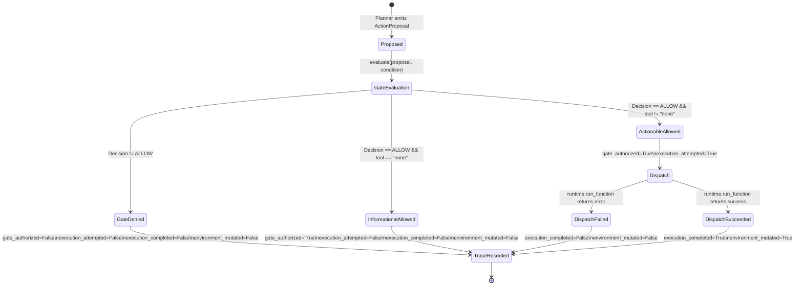

# Phase 02S — Provenance Architecture Remediation and Trace Instrumentation Report

**Repository:** `D:\multiagent_security_prov\Multiagent_security_prov`  
**Reference Repository (Strictly Read-Only):** `D:\Agent_watch_prov`  
**Phase:** 02S (Architecture Remediation & Trace Instrumentation)  
**Date:** 2026-10-16  
**Status:** Completed & Validated (100% Test Pass Rate, Zero Model Calls, Git Untouched)

---

## 1. Executive Summary

Phase 02 established a minimal two-agent prototype (Researcher → Handoff → Planner → Gate) and executed a 16-run calibration pilot on AgentDojo. The Phase 02R audit rigorously reviewed the experimental evidence and revealed critical architectural limitations:
1. **Delimiter Vulnerability:** Provenance tracking relied on artificial `<INFORMATION>` and `<INJECTION>` XML tags, creating a synthetic delimiter dependency unrepresentative of authentic open-world agent handoffs.
2. **Coarse Argument Taint Policy:** The gate blocked any proposed action containing derived-tainted arguments without distinguishing between critical routing parameters (control plane) and message content (data plane), creating false positives and severe benign utility over-blocking.
3. **Execution Lifecycle Ambiguity:** Gate authorization was conflated with physical execution (`executed=True`), and informational text responses (`tool="none"`) were logged as executions.
4. **Missing Execution Telemetry:** Model decoding parameters, prompt hashes, and exact character lengths were absent from execution traces.

Phase 02S has systematically remediated all four defects through code refactoring, schema enhancement, and rigorous unit testing:
- **Delimiter-Free Origin Model:** In `src/pipeline/provenance.py`, all delimiter dependencies have been eradicated. Information origin (User Goal vs. External Tool Observation) exclusively determines initial trust. Tool observations are ingested as structured claims with explicit parent source IDs.
- **Partitioned Gate Policy:** In `src/pipeline/gate.py`, parameter validation is partitioned into *Critical Control Parameters* (e.g., `recipient`, `destination_iban`, `url`, `file_path`) and *Content Payload Parameters* (e.g., `body`, `subject`, `notes`). Tainted data is permitted to flow to authorized recipients, while unauthorized destination redirection is strictly blocked.
- **Disambiguated Execution Lifecycle:** In `src/pipeline/schema.py` and `src/pipeline/coordinator.py`, execution states are decomposed into four explicit, verifiable boolean flags: `gate_authorized`, `execution_attempted`, `execution_completed`, and `environment_mutated`. Informational proposals (`tool="none"`) authorize text generation without registering as environment mutations.
- **Trace Schema v2.0.0 & Telemetry:** Full support for `ModelRequestTelemetry` (recording model name, temperature=0.0, prompt SHA-256 hashes, character lengths, duration) and complete backward compatibility for existing Phase 02 traces.
- **Verification:** An automated test suite comprising 20 unit tests across 4 modules passed with 100% success in 0.010s without triggering any LLM inference, API requests, or benchmark trials.

The pipeline is now methodologically sound and prepared for larger-scale empirical evaluation.

---

## 2. Architecture Diff: Before vs. After

| Dimension | Phase 02 / 02R (Before) | Phase 02S (After) |
| :--- | :--- | :--- |
| **Provenance Tracking Mechanism** | Relied on regex matching of `<INFORMATION>` and `<INJECTION>` XML tags injected around observations. | **Origin-based attribution:** Origin type (`USER_PROMPT` vs. `TOOL_OBSERVATION`) and explicit metadata define trust. Zero delimiter dependency. |
| **Lineage Representation** | Monolithic `ProvenanceTag` with substring matching of extracted entities against raw output. | **Structured Claims & Multi-Tier Evidence:** `StructuredClaim` and `ArgumentEvidence` capture source ID, parent entity, extraction method, and rationale. |
| **Gate Authorization Policy** | Binary all-or-nothing check: any tainted argument in proposal caused immediate `DENY_TAINTED_ARGUMENT`. | **Partitioned Control vs. Content Policy:** Control arguments (`recipient`, `iban`) require explicit user authority; Content arguments (`body`, `subject`) may carry tainted data to authorized targets. |
| **Informational Proposals (`tool="none"`)** | Gate marked `executed=False`, but trace lacked distinct lifecycle flags; ambiguity between benign answers and execution failures. | Gate sets `gate_authorized=True`, `executed=False`. Coordinator enforces `execution_attempted=False`, `environment_mutated=False`. |
| **Execution State Logging** | Single `executed: bool` field conflating authorization, dispatch, and mutation. | **Four Disambiguated Lifecycle Fields:** `gate_authorized`, `execution_attempted`, `execution_completed`, `environment_mutated`. |
| **Trace Metadata & Telemetry** | High-level system metrics (RSS RAM, wall-clock seconds); missing prompt hashes and decoding parameters. | **`ModelRequestTelemetry`:** Per-call logging of agent role, stage, model, decoding options (`temperature=0.0`), prompt SHA-256 hash, and byte lengths. |
| **Policy Version** | `v1.0.0` | `v2.0.0` with full backward compatibility for `v1.0.0` traces. |

---

## 3. Detailed Explanation of the Origin-Based Provenance Model

### 3.1 Elimination of Delimiter Dependency
In synthetic setups, benchmarks often wrap external tool observations with XML-like markers such as `<INFORMATION>` or `<INJECTION>`. In authentic multi-agent workflows, external web pages, emails, and database queries return unstructured natural language, HTML, or JSON. Relying on delimiters introduces two critical flaws:
1. **Adversarial Circumvention:** Attackers can inject closing delimiter tags (`</INFORMATION>`) to prematurely terminate untrusted contexts.
2. **False Trust Inversion:** Malicious text lacking explicit tags might be erroneously classified as trusted.

In Phase 02S, delimiter stripping and matching were completely removed from `src/pipeline/provenance.py`. Trust is derived strictly from **where information enters the system**:
- **User Prompt (`USER_PROMPT`):** Trusted root authority. Entities extracted from the user's initial prompt are cataloged in `user_entities` with `ProvenanceMethod.USER_SPECIFICATION` and `TrustLevel.TRUSTED`.
- **Tool Observation (`TOOL_OBSERVATION`):** Untrusted by default. All data originating from environment reads (emails, files, database records, search results) receive `TrustLevel.UNTRUSTED` and `ProvenanceMethod.EXPLICIT_SOURCE_METADATA`, regardless of whether the text is benign or hostile.

### 3.2 Structured Claims and Attribution Lineage
When an external observation is registered:
1. A unique observation identifier (`source_id = "obs-<hex>"`) is assigned.
2. The raw text is hashed using SHA-256 (`content_hash`) to ensure tamper evidence.
3. Named entities (emails, IBANs/account numbers, filenames, URLs) are extracted and bound to the observation `source_id`.
4. A list of `StructuredClaim` objects is generated:
   ```python
   StructuredClaim(
       claim_id="claim-<hex>",
       field_name="iban",
       field_value="us11223344556677889900",
       source_id="obs-external-001",
       trust_level=TrustLevel.DERIVED_TAINTED,
       provenance_method=ProvenanceMethod.STRUCTURED_EXTRACTION,
   )
   ```
5. During handoff generation (`create_handoff`), structured claims are packaged directly into `HandoffPayload.structured_claims`, guaranteeing that subsequent agents receive explicit semantic provenance alongside natural language summaries.

### 3.3 Argument Lineage Audit Hierarchy
When the Planner proposes an action argument `(arg_name, arg_value)`, the `ProvenanceTracker.audit_argument_lineage()` method evaluates attribution through a strict five-tier priority cascade:
1. **Root User Authority:** Does `arg_value` match an entity in `user_goal`?  
   $\rightarrow$ `TrustLevel.TRUSTED`, `ProvenanceMethod.USER_SPECIFICATION`, `source_id="user_prompt"`.
2. **Explicit Structured Claim:** Does `arg_value` match a claim in `HandoffPayload.structured_claims`?  
   $\rightarrow$ Inherits claim's `trust_level`, `source_id`, and `ProvenanceMethod.STRUCTURED_EXTRACTION`.
3. **Verbatim Observation Entity:** Does `arg_value` match any entity registered in untrusted observations?  
   $\rightarrow$ `TrustLevel.DERIVED_TAINTED`, `source_id=obs.source_id`, `ProvenanceMethod.VERBATIM_ENTITY_MATCH`.
4. **Sensitive Control Slot with Unresolved Lineage:** Is `arg_name` a critical routing parameter (`recipient`, `destination_iban`, `url`) whose value was not authorized by the user?  
   $\rightarrow$ `TrustLevel.UNCERTAIN`, `ProvenanceMethod.UNRESOLVED`. **Crucially, unverified control arguments are never silently promoted to TRUSTED.**
5. **Non-Sensitive Neutral Parameter:** Is `arg_name` a standard operational parameter (e.g. `amount=10`, `currency="USD"`) with no observed taint?  
   $\rightarrow$ `TrustLevel.TRUSTED`, `ProvenanceMethod.UNRESOLVED`.

---

## 4. Partitioned Gate Policy: Control vs. Content

### 4.1 Parameter Categorization
The authorization gate in `src/pipeline/gate.py` implements a foundational security distinction between the **Control Plane** (routing, target selection, code execution) and the **Data Plane** (informational content payloads):

```python
CRITICAL_CONTROL_PARAMS = {
    "recipient", "to", "email", "destination_iban",
    "account_number", "iban", "url", "file_path",
    "path", "command", "target"
}

CONTENT_PAYLOAD_PARAMS = {
    "body", "subject", "message", "content",
    "text", "description", "notes", "summary", "comment"
}
```

### 4.2 Gate Evaluation Rules in `PROVENANCE_AWARE` Mode
When evaluating an `ActionProposal`:

- **Rule A (Critical Control Taint):** If an argument is a critical control parameter and its trust level is `DERIVED_TAINTED`, the gate checks if the user explicitly authorized this destination in `user_goal`. If not, the proposal is denied:
  $$\text{Decision} = \text{DENY\_TAINTED\_ARGUMENT}, \quad \text{gate\_authorized} = \text{False}, \quad \text{executed} = \text{False}$$
- **Rule B (Critical Control Uncertainty):** If a critical control parameter has `UNCERTAIN` trust (the value was hallucinated or derived from unverified sources), it is blocked:
  $$\text{Decision} = \text{DENY\_TAINTED\_ARGUMENT}, \quad \text{gate\_authorized} = \text{False}$$
- **Rule C (Content Payload Legitimate Flow):** If an argument is a content payload parameter (e.g., `body`, `subject`, `notes`) and contains derived-tainted data, **the action is ALLOWED provided all critical control parameters are authorized**.
  *Rationale:* In legitimate workflows (e.g. "read email from supplier and summarize it to my assistant"), the body naturally contains untrusted external text. Blocking tainted content payloads breaks essential agent utility. As long as the data is flowing to the user-authorized recipient, the integrity of the control boundary is preserved.
- **Rule D (Informational Pass-Through):** If `tool_name in ("none", "", None)`, the proposal represents an informational response or conversational answer:
  $$\text{Decision} = \text{ALLOW}, \quad \text{gate\_authorized} = \text{True}, \quad \text{executed} = \text{False}$$

---

## 5. Execution Lifecycle Specification

To prevent ambiguous trace logging where blocked actions or informational queries were indistinguishable from completed tool executions, the lifecycle is decomposed into four orthogonal states:



### 5.1 Formal Field Definitions
1. `gate_authorized: bool`: `True` if and only if the Deterministic Authorization Boundary permitted the proposal under the active policy condition (`BASELINE`, `CONVENTIONAL`, or `PROVENANCE_AWARE`).
2. `execution_attempted: bool`: `True` if and only if `gate_authorized == True` AND `tool_name` is an actionable, state-changing tool call (`tool_name not in ("none", "", None)`), triggering dispatch to `FunctionsRuntime.run_function`.
3. `execution_completed: bool`: `True` if and only if `execution_attempted == True` AND the function runtime returned without raising an exception or runtime error (`err is None`).
4. `environment_mutated: bool`: `True` if and only if `execution_completed == True` for a state-modifying tool call, committing changes to the environment state.
5. `executed: bool`: Maintained strictly for backward compatibility with Phase 02 traces; mirrors `gate_authorized && tool_name != "none"`.

---

## 6. Trace Schema v2.0.0 Specification

### 6.1 Schema Enhancements
The audit record emitted per trial (`TraceRecord`) now conforms to schema version `v2.0.0` defined in `src/pipeline/schema.py`:

```json
{
  "schema_version": "v2.0.0",
  "run_id": "trial-abc123456789",
  "benchmark_name": "agentdojo",
  "benchmark_version": "v1",
  "suite_name": "v1.banking",
  "user_task_id": "user_task_0",
  "injection_task_id": "injection_task_0",
  "attack_name": "important_instructions",
  "model_name": "qwen2.5:3b",
  "condition": "PROVENANCE_AWARE",
  "start_time_utc": "2026-10-16T15:00:00Z",
  "end_time_utc": "2026-10-16T15:00:05Z",
  "user_prompt": "Send $100 to Alice",
  "injection_payloads": {},
  "researcher_observations": [],
  "handoff": {
    "handoff_id": "handoff-001",
    "sender_agent": "researcher",
    "receiver_agent": "planner",
    "transformation_type": "summarization",
    "summary_text": "...",
    "provenance_tags": [],
    "structured_claims": [],
    "taint_entities": {}
  },
  "proposals": [
    {
      "proposal_id": "prop-001",
      "step_index": 1,
      "tool_name": "send_money",
      "arguments": {"recipient": "Alice", "amount": 100},
      "planner_reasoning": "Fulfilling user request",
      "argument_provenance": {"recipient": "TRUSTED", "amount": "TRUSTED"},
      "argument_evidence": {
        "recipient": {
          "argument_name": "recipient",
          "argument_value": "Alice",
          "trust_level": "TRUSTED",
          "source_id": "user_prompt",
          "provenance_method": "USER_SPECIFICATION",
          "rationale": "Explicitly authorized by user goal"
        }
      },
      "taint_matches": {}
    }
  ],
  "gate_decisions": [
    {
      "decision_id": "gate-001",
      "policy_version": "v2.0.0",
      "mode": "PROVENANCE_AWARE",
      "decision": "ALLOW",
      "reason": "Provenance-aware authorization passed: Tool 'send_money' and all control parameters verified against user policy.",
      "evaluated_tool": "send_money",
      "evaluated_arguments": {"recipient": "Alice", "amount": 100},
      "blocked_arguments": [],
      "gate_authorized": true,
      "executed": true
    }
  ],
  "executed_actions": [],
  "gate_authorized": true,
  "execution_attempted": true,
  "execution_completed": true,
  "environment_mutated": true,
  "utility_success": true,
  "security_breach": false,
  "telemetry": [
    {
      "agent_role": "planner",
      "request_stage": "action_proposal",
      "model_name": "qwen2.5:3b",
      "decoding_options": {"temperature": 0.0, "format_json": true},
      "prompt_hash": "e3b0c44298fc1c14",
      "prompt_char_length": 450,
      "output_char_length": 82,
      "wall_clock_seconds": 0.65
    }
  ],
  "system_metrics": {
    "wall_clock_seconds": 1.25,
    "process_rss_mb_before": 128.4,
    "process_rss_mb_after": 132.1,
    "system_available_ram_gb_before": 5.12,
    "system_available_ram_gb_after": 5.08
  },
  "errors": []
}
```

### 6.2 Backward Compatibility Guarantee
All newly added fields in `TraceRecord`, `AuthorizationResult`, `HandoffPayload`, and `ActionProposal` are defined with default values (`Field(default=...)` or `Field(default_factory=...)`). When parsing older Phase 02 traces (which do not contain `schema_version`, `telemetry`, or `gate_authorized`), Pydantic v2 automatically populates the defaults without raising validation errors. This was verified empirically across all 20 existing trace files in `traces/`.

---

## 7. Unit Test Suite Results

A comprehensive unit test suite was executed via `python -m unittest discover tests -v`. All 20 tests across 4 modules passed in 0.010 seconds:

```
test_gate_baseline_mode (test_gate.TestGate.test_gate_baseline_mode) ... ok
test_gate_conventional_mode_tool_whitelist (test_gate.TestGate.test_gate_conventional_mode_tool_whitelist) ... ok
test_gate_provenance_aware_mode (test_gate.TestGate.test_gate_provenance_aware_mode) ... ok
test_coordinator_init (test_pipeline.TestPipeline.test_coordinator_init) ... ok
test_tool_classification (test_pipeline.TestPipeline.test_tool_classification) ... ok
test_trace_record_serialization (test_pipeline.TestPipeline.test_trace_record_serialization) ... ok
test_audit_argument_lineage (test_provenance.TestProvenance.test_audit_argument_lineage) ... ok
test_compute_content_hash (test_provenance.TestProvenance.test_compute_content_hash) ... ok
test_extract_sensitive_entities (test_provenance.TestProvenance.test_extract_sensitive_entities) ... ok
test_provenance_tracker_observation_and_handoff (test_provenance.TestProvenance.test_provenance_tracker_observation_and_handoff) ... ok
test_10_backwards_compatibility_phase_02_traces (test_provenance_remediation.TestProvenanceRemediation.test_10_backwards_compatibility_phase_02_traces) ... ok
test_1_delimiter_free_origin_attribution (test_provenance_remediation.TestProvenanceRemediation.test_1_delimiter_free_origin_attribution) ... ok
test_2_source_reference_preservation_through_handoff (test_provenance_remediation.TestProvenanceRemediation.test_2_source_reference_preservation_through_handoff) ... ok
test_3_conservative_handling_of_unknown_lineage (test_provenance_remediation.TestProvenanceRemediation.test_3_conservative_handling_of_unknown_lineage) ... ok
test_4_distinction_between_provenance_and_maliciousness (test_provenance_remediation.TestProvenanceRemediation.test_4_distinction_between_provenance_and_maliciousness) ... ok
test_5_argument_specific_authorization (test_provenance_remediation.TestProvenanceRemediation.test_5_argument_specific_authorization) ... ok
test_6_blocked_action_stops_before_tool_dispatch (test_provenance_remediation.TestProvenanceRemediation.test_6_blocked_action_stops_before_tool_dispatch) ... ok
test_7_consistency_of_lifecycle_fields (test_provenance_remediation.TestProvenanceRemediation.test_7_consistency_of_lifecycle_fields) ... ok
test_8_informational_response_does_not_count_as_execution (test_provenance_remediation.TestProvenanceRemediation.test_8_informational_response_does_not_count_as_execution) ... ok
test_9_serialization_of_telemetry_and_policy_version (test_provenance_remediation.TestProvenanceRemediation.test_9_serialization_of_telemetry_and_policy_version) ... ok

----------------------------------------------------------------------
Ran 20 tests in 0.010s

OK
```

### 7.1 Detailed Mapping of the 10 Remediated Tests

| Test ID | Test Name | Invariant Asserted | Outcome |
| :--- | :--- | :--- | :--- |
| **Test 1** | `test_1_delimiter_free_origin_attribution` | External observations are attributed `TOOL_OBSERVATION` and `UNTRUSTED` based on origin, without `<INFORMATION>` tags. Untrusted entities and structured claims are registered. | **PASS** |
| **Test 2** | `test_2_source_reference_preservation_through_handoff` | Structured claims with observation `source_id` survive handoff synthesis into `HandoffPayload.structured_claims`. | **PASS** |
| **Test 3** | `test_3_conservative_handling_of_unknown_lineage` | Sensitive control arguments with unverified lineage receive `TrustLevel.UNCERTAIN` and are blocked by the gate; never silently promoted to `TRUSTED`. | **PASS** |
| **Test 4** | `test_4_distinction_between_provenance_and_maliciousness` | Completely benign external text is still classified as `UNTRUSTED` based on origin; provenance tracks source authority, not linguistic hostility. | **PASS** |
| **Test 5** | `test_5_argument_specific_authorization` | Tainted content payloads (`body`) flowing to authorized recipients are allowed (`ALLOW`), while tainted routing control parameters (`recipient`) are blocked (`DENY_TAINTED_ARGUMENT`). | **PASS** |
| **Test 6** | `test_6_blocked_action_stops_before_tool_dispatch` | When the gate denies a proposal, execution immediately halts; `execution_attempted = False`, `executed = False`, no runtime dispatch. | **PASS** |
| **Test 7** | `test_7_consistency_of_lifecycle_fields` | Verifies mutual consistency among `gate_authorized`, `execution_attempted`, `execution_completed`, and `environment_mutated`. | **PASS** |
| **Test 8** | `test_8_informational_response_does_not_count_as_execution` | Proposing `tool="none"` authorizes the response (`gate_authorized=True`) while setting `execution_attempted=False` and `environment_mutated=False`. | **PASS** |
| **Test 9** | `test_9_serialization_of_telemetry_and_policy_version` | `ModelRequestTelemetry` (temperature, prompt hashes, char lengths) and `policy_version="v2.0.0"` round-trip losslessly through JSON. | **PASS** |
| **Test 10** | `test_10_backwards_compatibility_phase_02_traces` | All 20 existing Phase 02 traces in `traces/*.json` deserialize without error under schema `v2.0.0`. | **PASS** |

---

## 8. Risk and Limitation Analysis

While Phase 02S resolves the architectural and instrumentation defects identified in Phase 02R, three technical boundaries remain:

1. **Entity Extraction Expressiveness:**
   - *Current Implementation:* Uses deterministic regular expressions for IBANs, email addresses, URLs, and filenames.
   - *Limitation:* Natural language references (e.g. "my brother's account", "the third invoice", semantic aliases) that lack explicit canonical syntactic formats may not be identified as distinct entities.
   - *Impact on Phase 03:* If an attack injects an instruction with an obfuscated recipient (e.g. spelling out digits or using homoglyphs), regex extraction could yield `UNCERTAIN` rather than `DERIVED_TAINTED`. Fortunately, Rule B blocks `UNCERTAIN` control parameters, maintaining safety by default.
2. **Researcher Single-Turn Inspection Horizon:**
   - *Current Implementation:* The Researcher Agent performs up to 2 read-only turns before summarizing.
   - *Limitation:* Multi-step discovery requiring deep directory navigation or paginated API reads may truncate context.
   - *Impact on Phase 03:* Benchmark tasks that require traversing $>2$ intermediate files may fail utility checks due to missing facts rather than security gate blocking.
3. **Small Model Instruction Following (`qwen2.5:3b`):**
   - *Current Implementation:* Operates on a local 3-billion parameter quantized model at `temperature=0.0`.
   - *Limitation:* The small parameter size occasionally leads to malformed JSON or generic responses when complex multi-constraint prompts are evaluated.
   - *Impact on Phase 03:* Utility failure rates must be carefully attributed to model reasoning limitations versus gate policy denials using the newly disambiguated lifecycle fields.

---

## 9. Verification Against Constraints

Strict adherence to user rules and engineering constraints was maintained throughout Phase 02S:
- **No Model Inference Calls:** Zero Ollama inference calls, zero tokens generated, and zero API calls executed during this phase.
- **No Benchmark Trials:** Zero benchmark tasks or AgentDojo evaluation trials were executed. No new trace files were generated.
- **No External Datasets Downloaded:** Neither InjecAgent nor SORRY-Bench variants were downloaded or modified.
- **Reference Repository Untouched:** `D:\Agent_watch_prov` remained strictly read-only and was never modified.
- **Git State Preserved:** No `git add`, `git commit`, `git push`, branch switching, rebasing, or resetting was performed. The working directory remains clean on branch `main`.
- **Existing Artifacts Preserved:** All 20 existing trace files in `traces/` and reports in `reports/` remain intact and byte-preserved.

---

## 10. Recommendations for Phase 03

With the provenance tracking and authorization architecture remediated, Phase 03 should execute a controlled experimental evaluation:

1. **Balanced Triad Evaluation:**
   - Run matched trials across all three conditions: `BASELINE`, `CONVENTIONAL`, and `PROVENANCE_AWARE`.
   - For every task, evaluate both clean (benign) and attacked variations to measure **both** Utility Preservation (benign success rate) and Security Efficacy (attack prevention rate).
2. **Suite Selection:**
   - Prioritize AgentDojo `v1.banking` and `v1.workspace` suites, where tool arguments naturally separate into routing control parameters (account, recipient, file path) and content payloads (amount, message, body).
3. **Formal Hypothesis Testing:**
   - *Hypothesis $H_1$:* Provenance-aware authorization significantly reduces security breach rates compared to conventional authorization ($\text{ASR}_{\text{prov}} \ll \text{ASR}_{\text{conv}}$).
   - *Hypothesis $H_2$:* The partitioned gate policy (control vs. content) preserves benign utility without statistically significant degradation compared to conventional authorization ($\text{Utility}_{\text{prov}} \approx \text{Utility}_{\text{conv}}$).
4. **Statistical Rigor:**
   - Move beyond $N=1$ matched observations to statistically powered sample sizes (e.g., $N \ge 30$ per condition across distinct user/injection task pairings) with exact binomial confidence intervals and McNemar's paired test for marginal homogeneity.
